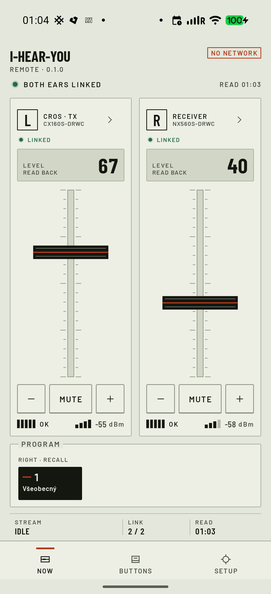
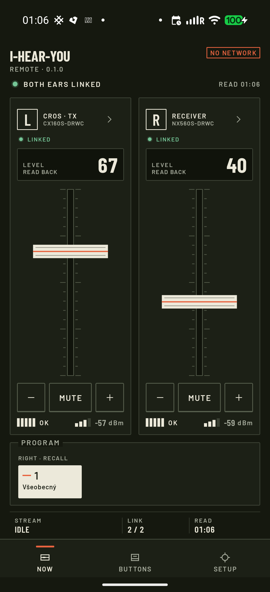
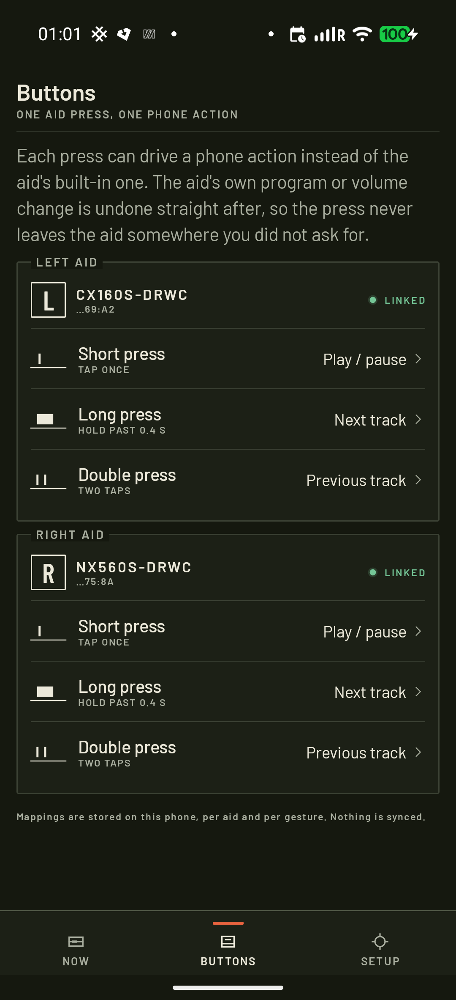

# I-Hear-You

An open-source Android remote for GN hearing aids (ReSound and its sister brands), for everyday
use: it works offline, needs no account, and maps the aid's own button to phone actions.

What it does: volume, mute, programs, battery, signal and stream state for each aid; the aid's
button mapped to media keys and other phone actions; and voice notes recorded from the aids,
transcribed on the phone and sent to a webhook or a White Noise (Marmot) group.

Website: https://jooray.github.io/i-hear-you/





## Which hearing aids

Tested on hardware: ReSound Nexia NX560S and NX460S with Nexia CROS CX160S (GN protocol 5.1).

Other GN aids should work if they use a protocol generation the app knows, but nobody has
tested them yet. The app knows GN protocols 1, 2, 3, 4, 5.0 and 5.1
(`protocol/src/main/kotlin/app/ihearyou/protocol/Platform.kt`) and reads the generation from
the aid's GN Version characteristic. If it does not recognise it, the aid stays read-only and the app writes nothing to it.
When looking for aids, the app recognises the GN brands ReSound, Beltone, Jabra Enhance,
Danalogic and Interton (`app/src/main/java/app/ihearyou/ble/AidFilter.kt`).

If you own another GN aid and try the app, please open an issue and tell us the model and what
worked. The log under Setup shows the protocol generation the aid reports.

Aids from other makers (Phonak, Oticon, Signia, Widex, Starkey and others) are not supported; they
speak different protocols. GN aids that require a passcode bond are not supported either. The app
does the boot bond only and tells you when an aid asks for a passcode.

## Install

- **[Zapstore](https://zapstore.dev/apps/app.ihearyou)** (recommended, updates arrive on their own)
- **Obtainium:** add `obtainium://add/https://github.com/jooray/i-hear-you`, or paste the
  repository URL into Obtainium
- **APK** from [GitHub Releases](https://github.com/jooray/i-hear-you/releases)

Release APKs are signed with a certificate whose SHA-256 is

```
79750fb49349ec3729be5a3e825507a15e47c6d987e854ae91d5d50a20b3a24d
```

Check it with `apksigner verify --print-certs I-Hear-You.apk`.

## First-time pairing

1. Take the aids out of the charger and pair both in Android's Bluetooth settings.
2. Open the app. The aids are already listed under Setup → Pair an aid (or tap "Pair" on the
   Now screen). You don't need to scan.
3. Tap an aid. When the app asks, put that aid in the charger for about 3 seconds and take it
   out again. The aid restarts and the app finishes the bond.
4. Do the same for the other aid.

Scan is only for aids that are not paired with Android yet.

## Status

Version 0.2.0 is the first public release. See [CHANGELOG.md](CHANGELOG.md).

Implemented and verified on hardware (ReSound Nexia + CROS, GN protocol 5.1):

| area | state |
|---|---|
| GN trusted bond (boot + session), AES-CTR+MIC, ECDH | done, verified |
| Handle channel (read/write/notify/discover) | done |
| Auto-reconnect supervisor: 2s→30s backoff; a background wait that hangs is restarted with a direct connect after 15 s, 30 s, 1, 2, 4, 8 min, and at once when Android sees the aid, on unlock or on opening the app; the fix banner shows only after that | done |
| Button bridge: 53 → short/long/double → media | done, verified |
| Compensation of the aid's own program/volume action | done, verified |
| Per-aid mapping UI | done |
| Device cards: model, fw, serial, side, CROS flag | done |
| Battery, signal (RSSI), stream state, program picker, volume slider, tap toggles | done |
| Sound Enhancer features (handle 36, feature id table, read-only) | done |
| In-app pairing (aids already paired with Android listed directly; scan for the rest → boot bond → power cycle → finalize) | done |
| Voice notes from the aid's button: record, transcribe with Offline Speech to Text, save, share, webhook, White Noise | done |
| Tabs (Now/Buttons/Setup), dark/light/system theme, en/sk/cs/de/es | done |
| Log with autoscroll | done |
| Unit tests (crypto, frames, masks, feature table) | passing |

Not implemented yet: equalizer UI (layout known: 52 B = 4×13), Auracast UI (framing known),
program rename, favourites, durable button actions.

### Design notes

- Protocol core: GN trusted bond (ECDH P-256 + application keys), AES-128-CTR + MIC, handle
  command channel, notification parsing, verified on Nexia / CROS hardware.
- BLE session with auto-reconnect supervision.
- Button bridge: handle 53 press/release -> short/long/double -> media control
  (NotificationListener) with compensation of the aid's own program/volume action.
- UI: "The Sealed Meter", a calibrated-instrument Compose design (pale enamel panel, near-black
  ink and one vermilion seal; hand-set light and dark schemes, Barlow/Barlow Condensed). Now,
  Buttons, Setup, Aid detail, first-run. Per-aid level faders with SENT/READ BACK, program strip,
  tap control, pairing, live log, sample pair for trying the UI without aids.

## Build

Requires **JDK 21** (JDK 17 also works; Gradle fails on Java 25 and newer) and the Android SDK
(compileSdk 36). MarmotKit (White Noise messaging, ~180 MB unpacked) is fetched and
checksum-verified, never committed:

```sh
export JAVA_HOME=/opt/homebrew/opt/openjdk@21/libexec/openjdk.jdk/Contents/Home
./tools/marmotkit/fetch.sh
./gradlew :app:assembleDebug
adb install -r app/build/outputs/apk/debug/app-debug.apk
```

Release builds (`./gradlew :app:assembleRelease`) are signed when
`~/.apk-signing-keystore/signing.properties` exists (`storeFile`, `storePassword`, `keyAlias`,
`keyPassword`). Without it the release APK is left unsigned.

## Privacy

No account. The aids are reached over the open BLE channel only; the app reports every code the
aid returns and never guesses a value. Network is used only by the optional voice-note
destinations the user sets up (a webhook URL, a White Noise group); with "Save only" nothing
leaves the phone. Transcription runs on the phone through Offline Speech to Text.

## Licence

MIT. The Barlow typefaces are under the SIL Open Font License 1.1
(`app/src/main/assets/fonts/OFL-Barlow.txt`). No device serial numbers, MAC addresses or vendor
branding are kept in the repository.

This project is not affiliated with or endorsed by GN Hearing. ReSound, Beltone, Jabra Enhance,
Danalogic and Interton are trademarks of their owners and are named here only to say which aids
the app works with.

## Docs

- `docs/PROTOCOL.md`: what goes over the air between the app and the aids (GATT service,
  handles, frames, pairing)
- `docs/VOICE-NOTES.md`: voice notes from the aids' buttons: recording, transcription,
  destinations (save, share, webhook, White Noise), replies in the aids, future ideas
- `docs/TESTING-VOICE.md`: short hands-on test guide for voice notes
- `docs/screens/`: screenshots of this app

## Support and value4value

If you like this project, I would appreciate if you contributed time, talent or treasure.

Time and talent can be used in testing it out, fixing bugs or submitting pull requests.

Treasure can be [sent back through here](https://juraj.bednar.io/en/support-me/).
Slovak speakers can use [juraj.bednar.io/podporte-ma](https://juraj.bednar.io/podporte-ma/).
